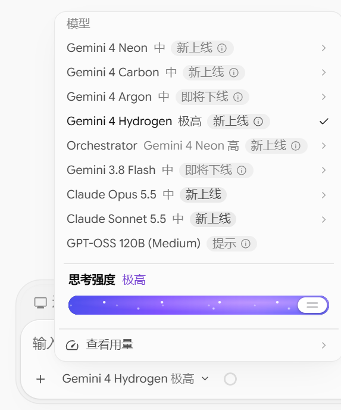

<div align="center">
  
  <h1>Regravity</h1>
  <p>Paquetes de idioma, métricas de sesión y cuotas de modelos, y control deslizante de nivel de razonamiento para Google Antigravity en Windows.</p>
  <p>
    <a href="https://github.com/wadewu-ml/regravity/releases/download/v4.2.3/antigravity-i18n.exe"><strong>Descargar para Windows x64</strong></a>
    ·
    <a href="https://github.com/wadewu-ml/regravity/releases">Versiones</a>
    ·
    Probado con <strong>Antigravity App 2.35.1</strong>
  </p>
  <p>
    <a href="./README.zh-CN.md">简体中文</a> · <a href="./README.md">English</a> · <a href="./README.zh-Hant.md">繁體中文</a> · <a href="./README.ja.md">日本語</a> · <a href="./README.ko.md">한국어</a> · <a href="./README.de.md">Deutsch</a> · <strong>Español</strong> · <a href="./README.fr.md">Français</a> · <a href="./README.pt-BR.md">Português (Brasil)</a> · <a href="./README.ru.md">Русский</a>
  </p>
  <p>antigravity-i18n ahora se llama Regravity. La descarga de arriba corresponde a la v4.2.3. Cuando se publique la primera versión de Regravity, descarga <code>regravity.exe</code> manualmente. Se conservarán los parches y la preferencia de actualización. Tras el cambio de nombre del repositorio, la v4.2.3 puede mostrar un error al comparar versiones. Consulta los lanzamientos en el enlace de arriba.</p>
</div>

<p align="center">
  <a href="./docs/images/language-settings.webp">
    
  </a>
</p>

## Funciones

- **9 idiomas en un solo EXE portátil** — Traduce ajustes, controles del chat, menús de modelos, menús nativos y avisos de salida al chino simplificado, chino tradicional, japonés, coreano, alemán, español, francés, portugués de Brasil y ruso sin alterar tus entradas ni conversaciones.
- **Métricas de sesión y cuotas (opcional)** — Añade un anillo junto al selector de modelo para consultar cuotas restantes, horarios locales de restablecimiento, contexto utilizado, velocidad media de salida, tasa de aciertos de caché y tiempo hasta el primer token.
- **Control de nivel de razonamiento (opcional)** — Añade un control deslizante tipo cápsula en el selector de modelos para los modelos compatibles.
- **Independiente y reversible byte a byte** — Ambos interruptores trabajan por separado y también con la interfaz oficial en inglés. Tras aplicar los cambios, puedes cerrar la herramienta y restaurar la versión oficial con una copia limpia de la misma versión de Antigravity.

## Inicio rápido

> [!NOTE]
> La interfaz de la herramienta está en chino simplificado. Las etiquetas originales aparecen entre paréntesis para coincidir con la captura anterior.

### Aplicar ajustes

1. Abre `antigravity-i18n.exe`. Si la ruta detectada no es correcta, pulsa **Cambiar ubicación** (`更改位置`) y selecciona la carpeta que contiene `Antigravity.exe`.
2. Elige un idioma en **Idioma de la interfaz** (`界面语言`) o deja **English** si solo quieres las funciones opcionales.
3. Activa **Métricas de sesión** (`会话指标`) y/o **Control de nivel de razonamiento** (`思考强度滑块`) debajo de la lista de idiomas según necesites.
4. Guarda tu trabajo, cierra Antigravity y pulsa **Aplicar cambios** (`应用更改`) abajo a la derecha. Antigravity se reabrirá con tus ajustes (o pulsa **Abrir Antigravity** / `打开 Antigravity`) y podrás cerrar la herramienta.

> [!WARNING]
> Si aparece un aviso de que Antigravity sigue abierto, guarda tu trabajo y ciérralo normalmente. Usar **Forzar el cierre y reintentar** (`强制退出并重试`) interrumpe sesiones activas y puede perder cambios sin guardar.

### Volver a aplicar o restaurar

- **Volver a aplicar los ajustes actuales** — Pulsa **Volver a aplicar** (`重新应用`) abajo a la derecha.
- **Restaurar la versión oficial** — Cierra Antigravity, abre el menú superior derecho (`···`), pulsa **Restaurar la versión oficial** (`还原官方版本`) y confirma. Se restablece la interfaz en inglés y se quitan el indicador y el control deslizante.

> [!IMPORTANT]
> La primera vez que aplicas los ajustes, la herramienta guarda una copia intacta en `resources/app.asar.clean-backup` dentro de la carpeta de instalación de Antigravity. Conserva ese archivo para poder restaurarlo.

## Funciones opcionales

### Métricas de sesión y cuotas de modelos

- **Cuotas antes del primer mensaje** — Pasa el puntero sobre el anillo junto al selector de modelo para ver la cuota restante por grupo y periodo (por ejemplo semanal y de 5 horas). Pasa el puntero sobre un porcentaje para ver la hora local de restablecimiento.
- **Métricas en vivo tras la primera llamada** — Cuando el chat registra una llamada al modelo, el anillo indica el uso estimado del contexto y la parte superior muestra **Contexto utilizado** (tokens usados, capacidad total y porcentaje), **Velocidad media de salida** (incluidos los tokens de razonamiento reportados), **Tasa de aciertos de caché** y **Tiempo hasta el primer token**. Haz clic en el anillo para fijar o cerrar el panel.
- **Precisión por panel** — Las vistas divididas, los chats laterales y los subagentes leen la llamada más reciente con datos del registro local de su propia sesión. Un `—` indica que el dato no está disponible.

<p align="center">
  <a href="./docs/images/session-quota-before-first-call.webp">
    
  </a>
</p>

### Control de nivel de razonamiento

Activa **Control de nivel de razonamiento** (`思考强度滑块`) y aplica los cambios. En el selector de modelos de Antigravity, los modelos compatibles mostrarán un control deslizante encima de la opción de uso: arrástralo para previsualizar el nivel y suéltalo para aplicarlo.

<p align="center">
  <a href="./docs/images/thinking-effort-high.webp">
    
  </a>
  &nbsp;&nbsp;
  <a href="./docs/images/thinking-effort-max.webp">
    
  </a>
</p>

## Actualizaciones

- **Tras actualizar Antigravity** — Si desaparecen la traducción o los controles, comprueba la versión compatible arriba y vuelve a aplicar tus ajustes desde la herramienta.
- **Actualizaciones automáticas de la herramienta** — Al iniciarse, usa el resultado de la última comprobación para decidir si consulta GitHub. Tras una comprobación correcta, espera al menos 24 horas. Un punto azul en el menú superior derecho (`···`) avisa de una nueva versión; abre el menú para leer las novedades y confirmar la descarga y reinicio desde la misma ruta del EXE. Puedes desactivar la búsqueda automática en **Acerca de** (`关于`) o buscar manualmente (`检查更新`). Tras actualizar, pulsa **Volver a aplicar** (`重新应用`) para aplicar las nuevas traducciones.

## CLI de PowerShell

Ejecuta estos comandos desde PowerShell en la carpeta que contiene `antigravity-i18n.exe`:

| Acción | Comando |
| --- | --- |
| Listar códigos de idioma | `.\antigravity-i18n.exe locales` |
| Aplicar español | `.\antigravity-i18n.exe apply --locale es` |
| Inglés oficial + métricas | `.\antigravity-i18n.exe apply --locale en --session-metrics` |
| Inglés oficial + control de razonamiento | `.\antigravity-i18n.exe apply --locale en --effort-slider` |
| Ver configuración actual | `.\antigravity-i18n.exe status` |
| Restaurar versión oficial | `.\antigravity-i18n.exe restore` |
| Ver todas las opciones | `.\antigravity-i18n.exe --help` |

## Compilar desde el código fuente

Requiere Windows, PowerShell 7, Go 1.26.3+ y la CLI de Wails v2:

```powershell
.\build.ps1 -Target gui
```

El ejecutable compilado se guarda en `build/bin/regravity.exe`.

## Solución de problemas

- **Aviso de WebView2 faltante al iniciar** — Instala el [entorno de ejecución de Microsoft Edge WebView2](https://developer.microsoft.com/en-us/microsoft-edge/webview2/#download) y vuelve a abrir `antigravity-i18n.exe`.

## Descargo de responsabilidad

1. Este es un proyecto no oficial mantenido por la comunidad y no está afiliado, respaldado ni autorizado por Google o Antigravity.
2. Google Antigravity y las marcas comerciales relacionadas pertenecen a sus respectivos propietarios.
3. Esta herramienta se proporciona para uso personal y educativo. Asegúrese de cumplir con los términos de servicio de software relevantes.

[Licencia MIT](./LICENSE)
