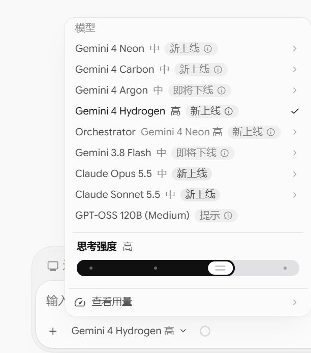

<div align="center">
  
  <h1>antigravity-i18n</h1>
  <p>Packs de langue, métriques de session et quotas de modèles, et curseur d’effort de raisonnement pour Google Antigravity sous Windows.</p>
  <p>
    <a href="https://github.com/wadewu-ml/antigravity-i18n/releases/latest/download/antigravity-i18n.exe"><strong>Télécharger pour Windows x64</strong></a>
    ·
    <a href="https://github.com/wadewu-ml/antigravity-i18n/releases">Versions</a>
    ·
    Testé avec <strong>Antigravity App 2.35.1</strong>
  </p>
  <p>
    <a href="./README.zh-CN.md">简体中文</a> · <a href="./README.md">English</a> · <a href="./README.zh-Hant.md">繁體中文</a> · <a href="./README.ja.md">日本語</a> · <a href="./README.ko.md">한국어</a> · <a href="./README.de.md">Deutsch</a> · <a href="./README.es.md">Español</a> · <strong>Français</strong> · <a href="./README.pt-BR.md">Português (Brasil)</a> · <a href="./README.ru.md">Русский</a>
  </p>
</div>

<p align="center">
  <a href="./docs/images/language-settings.webp">
    
  </a>
</p>

## Fonctionnalités

- **9 langues dans un seul EXE portable** — Traduit les réglages, les commandes du chat, les menus de modèles, les menus natifs et les confirmations de fermeture en chinois simplifié, chinois traditionnel, japonais, coréen, allemand, espagnol, français, portugais du Brésil et russe sans modifier vos messages ni vos saisies.
- **Métriques de session et quotas (facultatif)** — Ajoute un anneau près du sélecteur de modèle pour consulter les quotas restants, les heures locales de réinitialisation, le contexte utilisé, le débit moyen, le taux de réussite du cache et le délai avant le premier jeton.
- **Curseur d’effort de raisonnement (facultatif)** — Ajoute un curseur capsule intégré dans le sélecteur de modèles pour les modèles compatibles.
- **Indépendant et réversible à l’octet près** — Les deux interrupteurs fonctionnent indépendamment et avec l’interface anglaise d’origine. Une fois appliqués, vous pouvez fermer l’outil et restaurer la version officielle à tout moment.

## Démarrage rapide

> [!NOTE]
> L’interface de l’outil est en chinois simplifié. Les libellés d’origine sont indiqués entre parenthèses ci-dessous pour correspondre à la capture ci-dessus.

### Appliquer les réglages

1. Lancez `antigravity-i18n.exe`. Si le dossier détecté n’est pas le bon, cliquez sur **Changer d’emplacement** (`更改位置`) et choisissez le dossier contenant `Antigravity.exe`.
2. Sélectionnez une langue dans **Langue de l’interface** (`界面语言`), ou gardez **English** pour n’utiliser que les options facultatives.
3. Activez **Métriques de session** (`会话指标`) et/ou **Curseur d’effort de raisonnement** (`思考强度滑块`) sous la liste des langues selon vos besoins.
4. Enregistrez votre travail, quittez Antigravity puis cliquez sur **Appliquer les modifications** (`应用更改`) en bas à droite. Antigravity redémarre avec vos réglages (ou cliquez sur **Ouvrir Antigravity** / `打开 Antigravity`) et vous pouvez fermer l’outil.

> [!WARNING]
> Si l’outil indique qu’Antigravity est encore ouvert, enregistrez votre travail et fermez-le normalement. **Forcer la fermeture et réessayer** (`强制退出并重试`) interrompt les sessions actives et peut faire perdre des modifications non enregistrées.

### Réappliquer ou restaurer

- **Réappliquer les réglages actuels** — Cliquez sur **Réappliquer** (`重新应用`) en bas à droite.
- **Restaurer la version officielle** — Quittez Antigravity, ouvrez le menu en haut à droite (`···`), cliquez sur **Restaurer la version officielle** (`还原官方版本`) puis confirmez. L’interface anglaise d’origine est rétablie et l’indicateur ainsi que le curseur sont retirés.

> [!IMPORTANT]
> Lors de la première application, l’outil sauvegarde le fichier original sous `resources/app.asar.clean-backup` dans le dossier d’installation d’Antigravity. Conservez ce fichier pour pouvoir restaurer.

## Options facultatives

### Métriques de session et quotas de modèles

- **Quotas avant le premier message** — Survolez l’anneau à côté du sélecteur de modèle pour consulter le quota restant par groupe de modèles et par période (par exemple hebdomadaire et 5 heures). Survolez un pourcentage pour afficher l’heure locale de réinitialisation.
- **Métriques en direct après un appel** — Dès le premier appel enregistré, l’anneau reflète l’utilisation estimée du contexte et la partie supérieure affiche **Contexte utilisé** (jetons utilisés, capacité totale et pourcentage), **Débit moyen** (jetons de raisonnement inclus), **Taux de réussite du cache** et **Délai avant le premier jeton**. Cliquez sur l’anneau pour épingler ou fermer le panneau.
- **Suivi par panneau** — En vue partagée, dans les conversations latérales et pour les sous-agents, chaque panneau lit le dernier appel avec données de sa propre session locale. Un `—` indique une valeur indisponible.

<p align="center">
  <a href="./docs/images/session-quota-before-first-call.webp">
    
  </a>
</p>

### Curseur d’effort de raisonnement

Activez **Curseur d’effort de raisonnement** (`思考强度滑块`) et appliquez les changements. Dans le sélecteur de modèles d’Antigravity, les modèles compatibles affichent un curseur au-dessus de l’option d’utilisation : faites-le glisser pour prévisualiser un niveau et relâchez pour l’appliquer.

<p align="center">
  <a href="./docs/images/thinking-effort-high.webp">
    
  </a>
  &nbsp;&nbsp;
  <a href="./docs/images/thinking-effort-max.webp">
    
  </a>
</p>

## Mises à jour

- **Après une mise à jour d’Antigravity** — Si la traduction ou les options disparaissent, vérifiez la version prise en charge en haut de cette page puis réappliquez vos réglages.
- **Mises à jour automatiques de l’outil** — Au démarrage, l’outil vérifie GitHub toutes les 24 heures. Un point bleu sur le menu en haut à droite (`···`) signale une nouvelle version ; ouvrez le menu pour lire les notes et confirmer le téléchargement et le redémarrage depuis le même EXE. Vous pouvez désactiver la vérification automatique dans **À propos** (`关于`) ou vérifier manuellement (`检查更新`). Après la mise à jour, cliquez sur **Réappliquer** (`重新应用`) pour appliquer les nouvelles traductions.

## CLI PowerShell

Ouvrez PowerShell dans le dossier contenant `antigravity-i18n.exe` :

| Action | Commande |
| --- | --- |
| Lister les codes de langue | `.\antigravity-i18n.exe locales` |
| Appliquer le français | `.\antigravity-i18n.exe apply --locale fr` |
| Anglais officiel + métriques | `.\antigravity-i18n.exe apply --locale en --session-metrics` |
| Anglais officiel + curseur de raisonnement | `.\antigravity-i18n.exe apply --locale en --effort-slider` |
| Voir les réglages actuels | `.\antigravity-i18n.exe status` |
| Restaurer la version officielle | `.\antigravity-i18n.exe restore` |
| Voir toutes les options | `.\antigravity-i18n.exe --help` |

## Compiler depuis les sources

Nécessite Windows, PowerShell 7, Go 1.26.3+ et la CLI Wails v2 :

```powershell
.\build.ps1 -Target gui
```

L’exécutable est généré dans `build/bin/antigravity-i18n.exe`.

## Dépannage

- **WebView2 manquant au démarrage** — Installez le [runtime Microsoft Edge WebView2](https://developer.microsoft.com/en-us/microsoft-edge/webview2/#download) puis relancez `antigravity-i18n.exe`.

## Clause de non-responsabilité

1. Il s'agit d'un projet non officiel maintenu par la communauté et n'est ni affilié, ni approuvé ni autorisé par Google ou Antigravity.
2. Google Antigravity et les marques associées appartiennent à leurs propriétaires respectifs.
3. Cet outil est fourni pour un usage personnel et éducatif. Veuillez vous assurer du respect des conditions de service du logiciel concerné.

[Licence MIT](./LICENSE)
