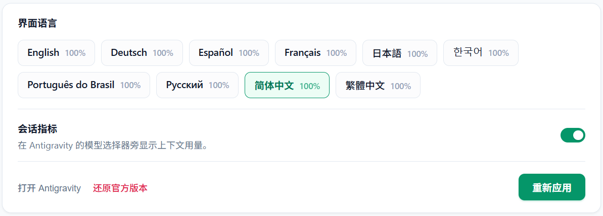

<div align="center">
  
  <h1>Regravity</h1>
  <p>Strumento portatile per Windows che traduce Google Antigravity e aggiunge metriche della sessione, quote dei modelli e un cursore per il livello di ragionamento.</p>
  <p>
    <a href="https://github.com/wadewu-ml/regravity/releases/latest/download/regravity.exe"></a>
    <a href="https://github.com/wadewu-ml/regravity/releases"></a>
    
    <a href="./LICENSE"></a>
  </p>
  <p>
    <sub>
      <a href="./README.zh-CN.md">简体中文</a> · <a href="./README.md">English</a> · <a href="./README.zh-Hant.md">繁體中文</a> · <a href="./README.ja.md">日本語</a> · <a href="./README.ko.md">한국어</a> · <a href="./README.de.md">Deutsch</a> · <a href="./README.es.md">Español</a> · <a href="./README.fr.md">Français</a> · <a href="./README.pt-BR.md">Português (Brasil)</a> · <a href="./README.ru.md">Русский</a> · <a href="./README.tr.md">Türkçe</a> · <a href="./README.vi.md">Tiếng Việt</a> · <strong>Italiano</strong> · <a href="./README.ar.md">العربية</a>
    </sub>
  </p>
</div>

## Primi passi

La versione di sviluppo include l’italiano. Il pulsante in alto scarica la versione stabile. Nel selettore in alto scegli **Italiano** per usare Regravity in italiano.

1. Apri `regravity.exe`. Se il percorso non è corretto, premi **Cambia percorso** e scegli la cartella che contiene `Antigravity.exe`.
2. In **Lingua di Antigravity**, scegli **Italiano**. Attiva le metriche della sessione e il cursore del livello di ragionamento se ti servono. Entrambi funzionano anche in inglese.
3. Salva il lavoro, esci da Antigravity e premi **Applica modifiche**. Quando Antigravity si riapre puoi chiudere Regravity.

> [!WARNING]
> L’uscita forzata interrompe le sessioni in corso e può causare la perdita delle modifiche non salvate.

<p align="center"><a href="./docs/images/language-settings.webp"></a></p>

## Quote, metriche e ragionamento

Passa il mouse sull’anello accanto al selettore del modello per vedere la quota residua e l’ora locale del ripristino. Dopo la prima chiamata compaiono anche il contesto utilizzato, la velocità media di generazione, i riscontri nella cache e il tempo al primo token. Fai clic per tenere aperti i dettagli. Ogni conversazione mostra i propri dati.

<p align="center"><a href="./docs/images/session-quota-before-first-call.webp"></a></p>

Nei modelli compatibili il cursore compare sopra la voce relativa all’utilizzo nel menu del modello. Trascina e rilascia per cambiare il livello di ragionamento.

<p align="center"><a href="./docs/images/thinking-effort-high.webp"></a> <a href="./docs/images/thinking-effort-max.webp"></a></p>

## Aggiornamenti e ripristino

- Dopo un aggiornamento di Regravity, premi **Applica di nuovo** per utilizzare le nuove traduzioni. Se un aggiornamento di Antigravity rimuove le personalizzazioni, controlla la compatibilità e riapplica le impostazioni.
- Un punto blu sul menu **···** segnala un aggiornamento. Puoi controllare manualmente dallo stesso menu o disattivare i controlli automatici in **Informazioni**. Con v4.2.3 o precedenti scarica manualmente il nuovo `regravity.exe`.
- Per tornare all’inglese originale e rimuovere le due funzioni, esci da Antigravity e scegli **··· → Ripristina versione originale**.

> [!IMPORTANT]
> Conserva la copia `resources/app.asar.clean-backup` creata alla prima applicazione: serve per ripristinare l’originale.

## PowerShell

Esegui i comandi dalla cartella di `regravity.exe`.

```powershell
.\regravity.exe locales
.\regravity.exe apply --locale it
.\regravity.exe apply --locale en --session-metrics
.\regravity.exe apply --locale en --effort-slider
.\regravity.exe status
.\regravity.exe restore
.\regravity.exe --help
```

Per compilare su Windows servono PowerShell 7, Go 1.26.3+ e Wails v2 CLI. Esegui `.\build.ps1 -Target gui` dalla cartella del progetto. Il risultato è `build/bin/regravity.exe`.

Se manca WebView2, installa [Microsoft Edge WebView2 Runtime](https://developer.microsoft.com/en-us/microsoft-edge/webview2/#download) e riapri Regravity.

## Licenza

Regravity è un progetto indipendente della comunità, senza affiliazione o approvazione da parte di Google o Antigravity. Google Antigravity e i relativi marchi appartengono ai rispettivi proprietari. Lo strumento è destinato all’uso personale e didattico nel rispetto delle condizioni del software utilizzato.

[Licenza MIT](./LICENSE)
