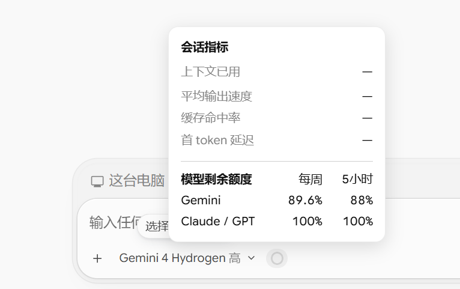

<div align="center">
  
  <h1>Regravity</h1>
  <p>Windows 版 Google Antigravity 向けの多言語パック、セッション指標・利用枠パネル、推論強度スライダー。</p>
  <p>
    <a href="https://github.com/wadewu-ml/regravity/releases/download/v4.2.3/antigravity-i18n.exe"><strong>Windows x64 版をダウンロード</strong></a>
    ·
    <a href="https://github.com/wadewu-ml/regravity/releases">リリース一覧</a>
    ·
    動作確認済み: <strong>Antigravity App 2.35.1</strong>
  </p>
  <p>
    <a href="./README.zh-CN.md">简体中文</a> · <a href="./README.md">English</a> · <a href="./README.zh-Hant.md">繁體中文</a> · <strong>日本語</strong> · <a href="./README.ko.md">한국어</a> · <a href="./README.de.md">Deutsch</a> · <a href="./README.es.md">Español</a> · <a href="./README.fr.md">Français</a> · <a href="./README.pt-BR.md">Português (Brasil)</a> · <a href="./README.ru.md">Русский</a>
  </p>
  <p>antigravity-i18n は Regravity に名称を変更しました。上のリンクからは v4.2.3 をダウンロードできます。Regravity の初回リリース時は <code>regravity.exe</code> を手動でダウンロードしてください。適用済みのパッチと自動更新設定は引き継がれます。リポジトリ名の変更により、v4.2.3 の更新確認でバージョン比較エラーが出ることがあります。上のリリース一覧をご確認ください。</p>
</div>

<p align="center">
  <a href="./docs/images/language-settings.webp">
    
  </a>
</p>

## 主な機能

- **ポータブル EXE 1 つに 9 言語を収録** — 設定、チャットのボタン、モデル選択メニュー、ネイティブメニュー、終了確認画面を簡体字中国語、繁体字中国語、日本語、韓国語、ドイツ語、スペイン語、フランス語、ブラジルポルトガル語、ロシア語に翻訳します。入力内容や会話履歴は書き換えません。
- **セッション指標と利用枠パネル（任意）** — モデル選択ボタンの横にリングを追加し、残り利用枠、現地時間のリセット時刻、コンテキスト使用量、平均出力速度、キャッシュヒット率、最初のトークンまでの時間を確認できます。
- **推論強度スライダー（任意）** — 推論強度を選べるモデルの選択メニュー内にカプセル型スライダーを追加します。
- **個別に有効化・バイト単位で復元** — 2 つのスイッチは個別に切り替えでき、標準の英語表示とも併用できます。適用後はツールを閉じても動作し、インストール済みの Antigravity と同じバージョンの未変更のバックアップから公式版へ復元できます。

## クイックスタート

> [!NOTE]
> 設定ツールの画面は簡体字中国語です。上のスクリーンショットと照合できるよう、以下に元の簡体字中国語ラベルを併記しています。

### 設定を適用する

1. `antigravity-i18n.exe` を開きます。インストール先が正しくない場合は **場所を変更**（`更改位置`）をクリックし、`Antigravity.exe` のあるフォルダーを選びます。
2. **表示言語**（`界面语言`）で言語を選びます（標準の英語のまま拡張機能だけ使う場合は **English** を選択）。
3. 必要に応じて言語一覧の下にある **セッション指標**（`会话指标`）や **推論強度スライダー**（`思考强度滑块`）をオンにします。
4. 作業を保存して Antigravity を終了し、右下の **変更を適用**（`应用更改`）をクリックします。Antigravity が新しい設定で再起動します（**Antigravity を開く** / `打开 Antigravity` からも起動可能）。その後はツールを閉じてかまいません。

> [!WARNING]
> Antigravity が起動中という案内が出た場合は、作業を保存して通常どおり終了してください。**強制終了して再試行**（`强制退出并重试`）を選ぶと進行中のセッションが中断され、未保存の変更が失われることがあります。

### 再適用と復元

- **現在の設定を再適用** — 右下の **再適用**（`重新应用`）をクリックします。
- **公式版に戻す** — Antigravity を終了し、右上のメニュー（`···`）から **公式版に戻す**（`还原官方版本`）をクリックして確定します。標準の英語表示に戻り、指標リングとスライダーも削除されます。

> [!IMPORTANT]
> 初回適用時に、Antigravity インストール先へ元のファイルが `resources/app.asar.clean-backup` としてバックアップされます。復元用にこのファイルを残しておいてください。

## 拡張機能の詳細

### セッション指標とモデルの残り利用枠

- **最初のメッセージ前から利用枠を確認** — モデル選択ボタン横のリングにポインターを合わせると、モデルグループごとの各期間（週間・5 時間など）の残り利用枠を確認できます。割合に合わせると現地時間のリセット日時が表示されます。
- **モデル呼び出し後のリアルタイム指標** — モデル呼び出しが記録されるとリングがコンテキスト推定使用率を示し、パネル上部に **コンテキスト使用量**（使用済みトークン / 総容量・割合）、**平均出力速度**（思考トークンを含む）、**キャッシュヒット率**、**最初のトークンまでの時間** が表示されます。リングをクリックすると固定・閉じられます。
- **パネルごとに正確に集計** — 分割画面、サイドチャット、サブエージェントの各パネルは、それぞれのセッションにローカル記録された直近のモデル呼び出しを表示します。取得できない項目は `—` で表示されます。

<p align="center">
  <a href="./docs/images/session-quota-before-first-call.webp">
    
  </a>
</p>

### 推論強度スライダー

設定ツールで **推論強度スライダー**（`思考强度滑块`）をオンにして変更を適用します。Antigravity のモデル選択メニューを開くと、推論強度を選べるモデルでは使用量の項目の上にスライダーが表示されます。ドラッグして段階を確認し、離すと適用されます。

<p align="center">
  <a href="./docs/images/thinking-effort-high.webp">
    
  </a>
  &nbsp;&nbsp;
  <a href="./docs/images/thinking-effort-max.webp">
    
  </a>
</p>

## アップデート

- **Antigravity の更新後** — 翻訳や拡張機能が消えた場合は、このページ上部の対応バージョンを確認のうえ、再度ツールから設定を適用してください。
- **ツールの自動更新** — 起動時に前回の確認結果を参照し、必要に応じて GitHub に問い合わせます。確認に成功すると、次の自動確認まで少なくとも 24 時間空けます。右上メニュー（`···`）に青い点が表示されたら、メニューから変更内容を確認して同じ EXE パスでそのままダウンロード・再起動できます。自動確認は **このツールについて**（`关于`）からオフにでき、手動確認（`检查更新`）も可能です。ツール更新後は **再適用**（`重新应用`）をクリックして新しい翻訳を Antigravity に反映してください。

## PowerShell CLI

`antigravity-i18n.exe` のあるフォルダーで PowerShell を開いて実行します：

| 操作 | コマンド |
| --- | --- |
| 言語コードを一覧表示 | `.\antigravity-i18n.exe locales` |
| 日本語を適用 | `.\antigravity-i18n.exe apply --locale ja` |
| 標準英語 + セッション指標 | `.\antigravity-i18n.exe apply --locale en --session-metrics` |
| 標準英語 + 推論強度スライダー | `.\antigravity-i18n.exe apply --locale en --effort-slider` |
| 現在の設定を確認 | `.\antigravity-i18n.exe status` |
| 公式版に復元 | `.\antigravity-i18n.exe restore` |
| 全オプションを表示 | `.\antigravity-i18n.exe --help` |

## ソースからビルドする

Windows、PowerShell 7、Go 1.26.3 以降、Wails v2 CLI が必要です：

```powershell
.\build.ps1 -Target gui
```

ビルドされた実行ファイルは `build/bin/regravity.exe` に出力されます。

## トラブルシューティング

- **起動時に WebView2 が必要と表示される** — [Microsoft Edge WebView2 ランタイム](https://developer.microsoft.com/en-us/microsoft-edge/webview2/#download) をインストールしてから `antigravity-i18n.exe` を再起動してください。

## 免責事項

1. 本プロジェクトはコミュニティにより保守される非公式ツールであり、Google または Antigravity 公式とは一切関係ありません。
2. Google Antigravity および関連商標の著作権は各権利者に帰属します。
3. 本ツールは学習・個人利用を目的として提供されます。関連する利用規約を遵守してご使用ください。

[MIT ライセンス](./LICENSE)
