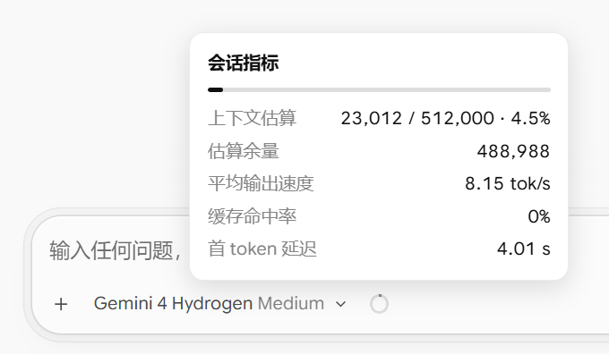

#  antigravity-i18n

Windows 版 Google Antigravity の設定、チャットのボタン、メニュー、終了時の確認画面を、日本語を含む 9 言語に翻訳できます。チャットの入力欄には、コンテキストの残量やモデルの出力速度も表示できます。設定を適用したら、ツールは閉じてかまいません。

[Windows x64 版をダウンロード](https://github.com/wadewu-ml/antigravity-i18n/releases/latest/download/antigravity-i18n.exe) · [リリース一覧](https://github.com/wadewu-ml/antigravity-i18n/releases)

対応を確認したバージョンは **Antigravity App 2.35.1** です。

[简体中文](./README.zh-CN.md) · [English](./README.md) · [繁體中文](./README.zh-Hant.md) · **日本語** · [한국어](./README.ko.md) · [Deutsch](./README.de.md) · [Español](./README.es.md) · [Français](./README.fr.md) · [Português (Brasil)](./README.pt-BR.md) · [Русский](./README.ru.md)

## 表示言語を変更する

言語パックは簡体字中国語、繁体字中国語、日本語、韓国語、ドイツ語、スペイン語、フランス語、ブラジルポルトガル語、ロシア語の 9 種類です。設定ツールの画面は簡体字中国語です。

1. `antigravity-i18n.exe` を開きます。正しいインストール先が表示されない場合は「場所を変更」をクリックし、`Antigravity.exe` のあるフォルダーを選びます。
2. 「表示言語」で表示言語を選びます。セッション指標を表示するには「セッション指標」をオンにします。元の英語表示のまま指標を使う場合は English を選びます。
3. 作業を保存して Antigravity を終了し、「変更を適用」をクリックします。新しい設定で Antigravity が起動します。

終了を求められたときに「強制終了して再試行」を選ぶと、Antigravity が強制終了して処理を再試行します。進行中のセッションは中断され、未保存の変更が失われることがあります。

画像の右下にある緑色の「重新应用」ボタンで、設定を再適用できます。

## セッション指標を見る

モデル選択ボタンの横のリングにポインターを合わせると、モデルグループごとに各期間の残り利用枠を確認できます。割合にポインターを合わせると、次のリセット日時（現地時間）が表示されます。最初のメッセージを送る前から利用できます。モデル呼び出しが記録されると、リングはコンテキストの推定使用率を示し、詳細には使用済みトークン数と総容量、出力速度、キャッシュヒット率、最初のトークンまでの待ち時間が表示されます。クリックすると詳細が固定され、もう一度クリックすると閉じます。

分割画面、サイドチャット、サブエージェントの各パネルには、それぞれのセッションでローカルに記録された直近のモデル呼び出しの値が表示されます。出力数にはモデルが記録した思考トークンも含まれます。値を取得できない項目は `—` で表示されます。

## 元に戻す・再適用する

元の英語表示に戻して指標を削除するには、Antigravity を終了し、ツールで「公式版に戻す」をクリックして「復元」で確定します。ツールは初回適用時に元のファイルをバックアップします。復元用に、インストール先の `resources/app.asar.clean-backup` を保管してください。

Antigravity の更新後に翻訳や指標が消えた場合は、このページの冒頭で対応バージョンを確認してから言語と指標を選び直して適用します。すでに有効な設定を再適用するときは「再適用」をクリックします。

ツールを更新するには、ウィンドウ右上の更新確認ボタン（检查更新）を押します。クリックすると GitHub で最新版を確認します。ダウンロードを承認すると、元の EXE と同じ場所から新版が起動します。新しい翻訳を Antigravity に反映するには、設定を再適用してください。

## PowerShell のコマンド

`antigravity-i18n.exe` のあるフォルダーで PowerShell を開きます。

| 操作 | コマンド |
| --- | --- |
| 言語コードを一覧表示 | `.\antigravity-i18n.exe locales` |
| 日本語を適用 | `.\antigravity-i18n.exe apply --locale ja` |
| 公式英語で指標を表示 | `.\antigravity-i18n.exe apply --locale en --session-metrics` |
| 現在の設定を確認 | `.\antigravity-i18n.exe status` |
| 公式版に復元 | `.\antigravity-i18n.exe restore` |
| 全オプションを表示 | `.\antigravity-i18n.exe --help` |

## ソースからビルドする

Windows でビルドするには、PowerShell 7、Go 1.26.3 以降、Wails v2 CLI が必要です。リポジトリのルートで `.\build.ps1 -Target gui` を実行すると `build/bin/antigravity-i18n.exe` が生成されます。

## 起動時のトラブル

ツールの起動時に WebView2 が必要と表示された場合は、[Microsoft Edge WebView2 ランタイム](https://developer.microsoft.com/en-us/microsoft-edge/webview2/#download)をインストールしてください。

## 免責事項

1. 本プロジェクトはコミュニティにより保守される非公式ツールであり、Google または Antigravity 公式とは一切関係ありません。
2. Google Antigravity および関連商標の著作権は各権利者に帰属します。
3. 本ツールは学習・個人利用を目的として提供されます。関連する利用規約を遵守してご使用ください。

[MIT ライセンス](./LICENSE)
