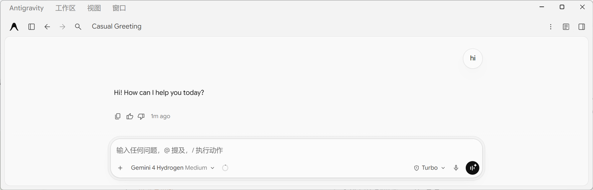

#  antigravity-i18n

Девять языковых пакетов переводят настройки, элементы управления чатом, меню и запросы на подтверждение выхода в Google Antigravity для Windows. В поле ввода можно также вывести индикатор, который показывает, сколько контекста осталось и с какой скоростью модель выдавала ответ. После применения настроек утилиту можно закрыть.

[Скачать для Windows x64](https://github.com/wadewu-ml/antigravity-i18n/releases/latest/download/antigravity-i18n.exe) · [Выпуски](https://github.com/wadewu-ml/antigravity-i18n/releases)

Совместимость проверена с **Antigravity App 2.35.1**. Переносимый EXE включает все девять языковых пакетов.

[简体中文](./README.zh-CN.md) · [English](./README.md) · [繁體中文](./README.zh-Hant.md) · [日本語](./README.ja.md) · [한국어](./README.ko.md) · [Deutsch](./README.de.md) · [Español](./README.es.md) · [Français](./README.fr.md) · [Português (Brasil)](./README.pt-BR.md) · **Русский**

## Как изменить язык интерфейса

Доступны упрощённый и традиционный китайский, японский, корейский, немецкий, испанский, французский, бразильский португальский и русский. Интерфейс самой утилиты — на упрощённом китайском.

1. Откройте `antigravity-i18n.exe`. Если утилита не нашла нужную установку, нажмите «Изменить расположение» и выберите папку с файлом `Antigravity.exe`.
2. Выберите язык в разделе «Язык интерфейса». Включите «Показатели сессии», чтобы видеть показатели сессии. Чтобы пользоваться ими с исходным английским интерфейсом, выберите English.
3. Сохраните изменения и закройте Antigravity, затем нажмите «Применить изменения», чтобы применить настройки. Antigravity откроется с новыми настройками.

Кнопка «Завершить принудительно и повторить» в окне запроса на выход принудительно завершает Antigravity и повторяет операцию. Активные сессии прерываются, несохранённые изменения могут быть потеряны.

Чтобы включить ползунок, в окне настройки включите переключатель под метриками сеанса. Обе функции можно включать по отдельности, в том числе в английском интерфейсе. Примените изменения и откройте меню выбора модели. Если модель позволяет выбрать уровень рассуждений, над пунктом просмотра использования появится ползунок. Перетащите его и отпустите, чтобы применить выбранный уровень.

Кнопка «重新应用» в правом нижнем углу повторно применяет текущие настройки.

  
  

## Как читать показатели сессии

Наведите указатель на кольцо рядом с переключателем модели, чтобы увидеть остаток квоты для каждой группы моделей по периодам. Наведите указатель на процент, чтобы увидеть местное время следующего сброса. Квоту можно проверить ещё до первого сообщения. После первого зарегистрированного вызова модели кольцо показывает оценку заполнения контекста. На панели также видны число занятых токенов и полная ёмкость контекста, скорость вывода, доля попаданий в кеш и время до первого токена. Щелчок по кольцу закрепляет панель, повторный щелчок закрывает её.

[Панель квот до первого вызова модели](./docs/images/session-quota-before-first-call.webp)

В разделённом окне, боковых чатах и панелях субагентов показатели берутся из последнего вызова модели, для которого есть данные в локальной записи соответствующей сессии. В число выходных токенов входят токены рассуждения, которые указала модель. Знак `—` означает, что значение недоступно.

## Возврат к оригиналу и повторное применение

Чтобы вернуть исходный английский интерфейс и убрать индикатор со слайдером, закройте Antigravity, откройте меню в правом верхнем углу окна, нажмите «Восстановить официальную версию» (还原官方版本) и подтвердите действие кнопкой «Восстановить». При первом применении настроек утилита сохраняет копию исходного файла. Для восстановления сохраните `resources/app.asar.clean-backup` в папке установки Antigravity.

Если после обновления Antigravity перевод или индикатор пропали, сверьте свою версию с указанной в начале страницы, затем заново выберите и примените настройки. Чтобы повторно применить уже действующие настройки, нажмите «Применить повторно».

При запуске утилита проверяет обновления, если с последней успешной проверки прошло не менее 24 часов. Синяя точка в правом верхнем углу меню означает, что доступна новая версия. Откройте меню, чтобы прочитать список изменений. Автопроверку можно отключить в разделе «О программе» (关于). Ручная проверка (检查更新) останется доступной. Подтвердите загрузку, и новая версия запустится из того же EXE-файла. Чтобы новые переводы появились в Antigravity, примените настройки ещё раз.

## Команды PowerShell

Откройте PowerShell в папке с `antigravity-i18n.exe`.

| Действие | Команда |
| --- | --- |
| Список кодов языков | `.\antigravity-i18n.exe locales` |
| Применить русский язык | `.\antigravity-i18n.exe apply --locale ru` |
| Использовать английский с показателями | `.\antigravity-i18n.exe apply --locale en --session-metrics` |
| Использовать английский с ползунком уровня рассуждений | `.\antigravity-i18n.exe apply --locale en --effort-slider` |
| Посмотреть текущие настройки | `.\antigravity-i18n.exe status` |
| Восстановить официальную версию | `.\antigravity-i18n.exe restore` |
| Посмотреть все параметры | `.\antigravity-i18n.exe --help` |

## Сборка из исходного кода

Для сборки в Windows установите PowerShell 7, Go 1.26.3 или новее и Wails v2 CLI. Выполните `.\build.ps1 -Target gui` в корне репозитория. Файл появится в `build/bin/antigravity-i18n.exe`.

## Проблемы при запуске

Если при запуске утилита запросит WebView2, установите [среду выполнения Microsoft Edge WebView2](https://developer.microsoft.com/en-us/microsoft-edge/webview2/#download).

## Отказ от ответственности

1. Это неофициальный проект, поддерживаемый сообществом, который не связан, не одобрен и не авторизован Google или Antigravity.
2. Google Антигравитация и связанные с ней товарные знаки принадлежат соответствующим владельцам.
3. Этот инструмент предназначен для личного и образовательного использования. Обеспечьте соблюдение соответствующих условий обслуживания программного обеспечения.

[Лицензия MIT](./LICENSE)
